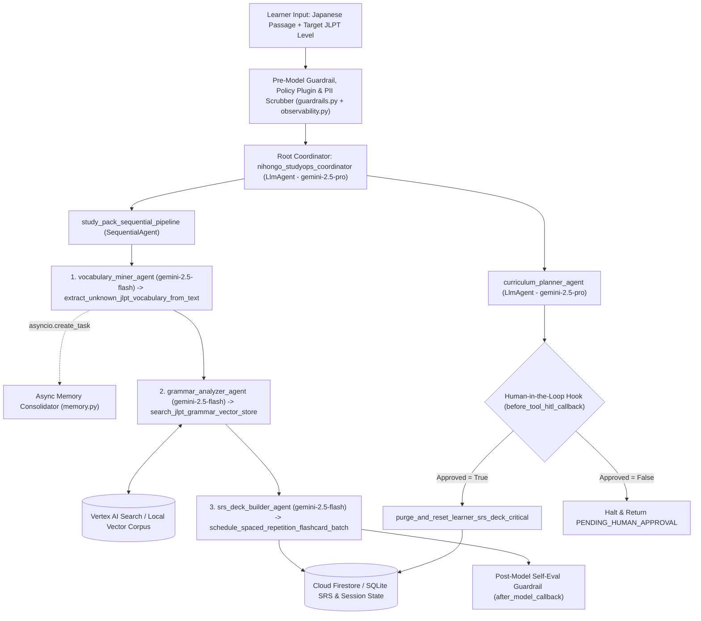

# Nihongo StudyOps Agent (`nihongo-studyops-agent`)

An autonomous multi-agent Japanese reading-to-Anki study-pack pipeline built with the **Google Agent Development Kit (ADK)**, **Vertex AI Gemini 2.5**, **Cloud Firestore**, **Vertex AI Search (Discovery Engine)**, and **OpenTelemetry**.

Instead of a monolithic conversational chatbot, `nihongo-studyops-agent` transforms raw Japanese reading passages (such as news articles or technical prose) into structured, level-calibrated **JLPT N5–N1 Anki Study Packs**:

1. **Comprehensible Input (`i+1`) Vocabulary Mining:** Extracts unknown Japanese words near the learner's target JLPT level, filters out vocabulary the learner has already mastered in persistent storage, and triggers non-blocking background memory consolidation (`asyncio.create_task`).
2. **Corpus-Grounded JLPT Grammar Analysis:** Queries a persistent Vertex AI Search / SQLite grammar corpus to retrieve verified morphological formation rules and bilingual example sentences.
3. **Spaced-Repetition (SM-2) Scheduling & Anki TSV Export:** Computes SM-2 review intervals (`ease_factor`, `interval_days`, `next_review_iso`), formats ready-to-import tab-separated Anki rows (`Front\tBack\tTags`), and persists cards to Cloud Firestore (with automatic local SQLite fallback for offline execution).
4. **Diagnostic Curriculum Planning & Human-in-the-Loop (HITL) Governance:** Routes complex study planning and high-stakes deck reset operations to a high-reasoning planner agent gated by an explicit `before_tool_callback` confirmation stop.

---

## System Architecture



---

## Production AgentOps Architecture & Capability Matrix

The table below maps all 19 production AgentOps engineering capabilities to their implementation modules and automated tests:

| Category | Capability | Implementation Evidence in Repository | Verification Test |
| :--- | :--- | :--- | :--- |
| **1. Tool & Interface Design** | **Comprehensive Tool Docstrings** | All 4 tools in `nihongo_agent/tools.py` include Google-style docstrings detailing purpose, `Args:` for every parameter, and `Returns:`. | `test_1_1_and_1_2_descriptive_tool_names_and_comprehensive_docstrings` |
| **1. Tool & Interface Design** | **Descriptive Naming** | Explicit verb-noun tool names: `extract_unknown_jlpt_vocabulary_from_text`, `search_jlpt_grammar_vector_store`, `schedule_spaced_repetition_flashcard_batch`, `purge_and_reset_learner_srs_deck_critical`. | `test_1_1_and_1_2_descriptive_tool_names_and_comprehensive_docstrings` |
| **1. Tool & Interface Design** | **Explicit JSON Schemas** | Strict Pydantic v2 `BaseModel` contracts with `ConfigDict(extra="forbid")` and field validators in `nihongo_agent/schemas.py`. | `test_1_3_strict_pydantic_v2_input_and_output_schemas` |
| **1. Tool & Interface Design** | **Guided Error Handling** | Every tool catches `ValidationError` and domain errors to return structured `recovery_instructions` to the LLM instead of raising unhandled exceptions (`nihongo_agent/tools.py`). | `test_1_4_guided_error_handling_returns_recovery_instructions` |
| **2. Context & Memory** | **Robust System Instructions** | XML-structured `<AGENT_CONSTITUTION>` prompts (`<PERSONA>`, `<DOMAIN_KNOWLEDGE>`, `<OPERATIONAL_CONSTRAINTS>`, `<OUTPUT_PROTOCOL>`) in `nihongo_agent/prompts.py`. | `test_2_1_robust_xml_system_constitutions` |
| **2. Context & Memory** | **History Compaction** | `compact_conversation_history()` (token-budget truncation, sliding window, older-turn summarization) and `configure_vertex_context_cache()` in `nihongo_agent/memory.py`, plus ADK `EventsCompactionConfig` on `app` (`nihongo_agent/agent.py`). | `test_2_2_history_compaction_and_vertex_context_caching` |
| **2. Context & Memory** | **Persistent Session State** | `PersistentLearnerMemoryStore` in `nihongo_agent/memory.py` connecting to Vertex AI Search (`discoveryengine_v1`) and Cloud Firestore (`google.cloud.firestore`) with automatic local SQLite fallback, plus `DatabaseSessionService`. | `test_2_3_and_2_4_persistent_session_state_and_async_memory_operations` |
| **2. Context & Memory** | **Async Memory Operations** | `consolidate_and_persist_memory_async()` and `schedule_background_memory_consolidation()` using `asyncio.create_task()` in `nihongo_agent/memory.py`. | `test_2_3_and_2_4_persistent_session_state_and_async_memory_operations` |
| **3. Orchestration & Logic** | **Multi-Agent Patterns** | Root `LlmAgent` coordinator (`nihongo_studyops_coordinator`) delegating to a 3-stage `SequentialAgent` (`study_pack_sequential_pipeline`) and specialist `curriculum_planner_agent` in `nihongo_agent/agent.py`. | `test_3_1_and_3_2_multi_agent_patterns_and_strategic_model_routing` |
| **3. Orchestration & Logic** | **Strategic Model Routing** | `select_model_for_task()` in `nihongo_agent/agent.py` routing fast extraction/lookup/scheduling to `gemini-2.5-flash` and complex coordination/planning to `gemini-2.5-pro`. | `test_3_1_and_3_2_multi_agent_patterns_and_strategic_model_routing` |
| **3. Orchestration & Logic** | **Guardrails & Policy Plugins** | `evaluate_input_guardrails()`, `before_model_guardrail_callback()`, `self_evaluate_study_pack_output()`, `after_model_self_eval_callback()`, and `StudyOpsPolicyPlugin(BasePlugin)` in `nihongo_agent/guardrails.py`. | `test_3_3_guardrails_and_self_evaluation_plugin` |
| **3. Orchestration & Logic** | **Human-in-the-Loop Hooks** | `before_tool_hitl_callback()` in `nihongo_agent/guardrails.py` intercepting `purge_and_reset_learner_srs_deck_critical` and returning `PENDING_HUMAN_APPROVAL` until human confirmation is granted. | `test_3_4_human_in_the_loop_hook_blocks_unapproved_destructive_reset` |
| **4. Observability & Tracing** | **Structured JSON Logging** | `StructuredJsonFormatter` and `get_structured_logger()` in `nihongo_agent/observability.py` emitting single-line JSON records with zero `print()` statements across the package. | `test_4_1_4_2_4_3_structured_json_logging_intent_outcome_and_otel_tracing` |
| **4. Observability & Tracing** | **Intent vs. Outcome Capture** | `log_agent_intent(phase="INTENT")`, `log_agent_outcome(phase="OUTCOME")`, and `@observe_tool_execution` in `nihongo_agent/observability.py` recording pre-execution intent, post-execution status, and `latency_ms`. | `test_4_1_4_2_4_3_structured_json_logging_intent_outcome_and_otel_tracing` |
| **4. Observability & Tracing** | **Distributed Tracing** | OpenTelemetry `TracerProvider`, `SimpleSpanProcessor`, and `trace_span()` context manager in `nihongo_agent/observability.py` linking parent pipeline spans and child tool spans. | `test_4_1_4_2_4_3_structured_json_logging_intent_outcome_and_otel_tracing` |
| **4. Observability & Tracing** | **PII Redaction** | `PiiRedactionScrubber` and `scrub_pii()` in `nihongo_agent/observability.py` combining deterministic regex rules (email, phone, SSN, JP MyNumber, API keys) with optional `google.cloud.dlp_v2.DlpServiceClient`. | `test_4_4_pii_redaction_scrubber` |
| **5. Infrastructure & CI/CD** | **Automated Evaluation Suites** | Offline regression test suite (`tests/test_eval_suite.py`) evaluated against `tests/golden_dataset.json` and executed on push/PR via `.github/workflows/ci.yml`. | `test_5_1_golden_dataset_study_pack_scenarios_end_to_end` |
| **5. Infrastructure & CI/CD** | **Infrastructure as Code** | Declarative Terraform configurations in `terraform/main.tf`, `terraform/variables.tf`, and `terraform/outputs.tf` plus `adk` / `agents-cli` deployment documentation below. | `test_5_2_terraform_iac_and_readme_cli_documentation` |
| **5. Infrastructure & CI/CD** | **Secure Secret Management** | `SecretResolver` and `get_secret()` in `nihongo_agent/secrets.py` using `SecretManagerServiceClient` with environment fallback and zero hardcoded credentials. | `test_5_3_secure_secret_management_with_environment_fallback` |

---

## Repository Structure

```text
nihongo-studyops-agent/
├── .github/workflows/ci.yml       # Automated GitHub Actions regression test pipeline
├── nihongo_agent/
│   ├── __init__.py                # Exports root_agent and app for ADK CLI discovery
│   ├── agent.py                   # Multi-agent orchestration (Coordinator + SequentialAgent) & model routing
│   ├── guardrails.py              # Input sanitization, self-eval callback, StudyOpsPolicyPlugin & HITL hook
│   ├── memory.py                  # History compaction, Vertex context cache, Firestore/SQLite store & async tasks
│   ├── observability.py           # PII scrubber (regex + Cloud DLP), OpenTelemetry spans & JSON logging
│   ├── prompts.py                 # XML-structured <AGENT_CONSTITUTION> system instructions
│   ├── schemas.py                 # Strict Pydantic v2 input/output models (extra="forbid")
│   ├── secrets.py                 # Google Cloud Secret Manager client with env fallback
│   └── tools.py                   # Four descriptive JLPT study-pack tools with guided error recovery
├── terraform/
│   ├── main.tf                    # APIs, least-privilege Service Account, Firestore, Discovery Engine & Secrets
│   ├── outputs.tf                 # Provisioned resource identifiers
│   └── variables.tf               # Parameterized GCP project, region, and environment variables
├── tests/
│   ├── golden_dataset.json        # Golden Japanese reading passages and adversarial edge cases
│   └── test_eval_suite.py         # Automated offline evaluation harness (pytest & unittest compatible)
├── pyproject.toml                 # Package metadata and pytest configuration
├── requirements.txt               # Runtime and evaluation dependencies
└── README.md                      # Architecture, capability matrix, and CLI usage guide
```

---

## Quick Start & Offline Evaluation

All cloud integrations (Vertex AI Search, Cloud Firestore, Secret Manager, Cloud DLP) include automatic local fallbacks so the entire evaluation suite runs 100% offline without cloud credentials:

```bash
# 1. Create and activate a virtual environment
python3 -m venv .venv
source .venv/bin/activate
pip install -r requirements.txt

# 2. Run the automated evaluation suite against the golden dataset
pytest -v

# Or run with Python's built-in unittest runner:
python3 -m unittest discover -s tests -v
```

---

## Running & Deploying with Google ADK and `agents-cli`

### Local Interactive Development (`adk`)

```bash
# Run the interactive CLI session against the root coordinator agent
adk run nihongo_agent

# Launch the browser-based ADK developer UI (inspect traces, state, and tool calls)
adk web .

# Run ADK evaluation against an evalset definition
adk eval nihongo_agent tests/golden_dataset.json
```

### Provisioning Cloud Infrastructure (`terraform`)

```bash
cd terraform
terraform init
terraform fmt -check
terraform validate
terraform plan -var="project_id=your-gcp-project-id" -var="region=us-central1"
terraform apply -var="project_id=your-gcp-project-id" -var="region=us-central1"
```

### Deploying to Vertex AI Agent Engine (`adk` / `agents-cli`)

```bash
# Deploy directly to Vertex AI Agent Engine via ADK CLI
adk deploy agent_engine \
  --project="your-gcp-project-id" \
  --region="us-central1" \
  --staging_bucket="gs://your-gcp-project-id-adk-staging" \
  --display_name="nihongo-studyops-agent" \
  nihongo_agent

# Or deploy via agents-cli / Agent Starter Pack workflow
agents-cli deploy \
  --agent-path="./nihongo_agent" \
  --project="your-gcp-project-id" \
  --region="us-central1" \
  --service-account="nihongo-studyops-agent-prod@your-gcp-project-id.iam.gserviceaccount.com"
```

---

## License

Apache License 2.0
